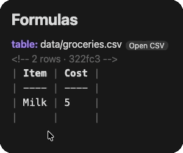
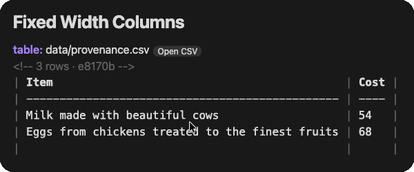
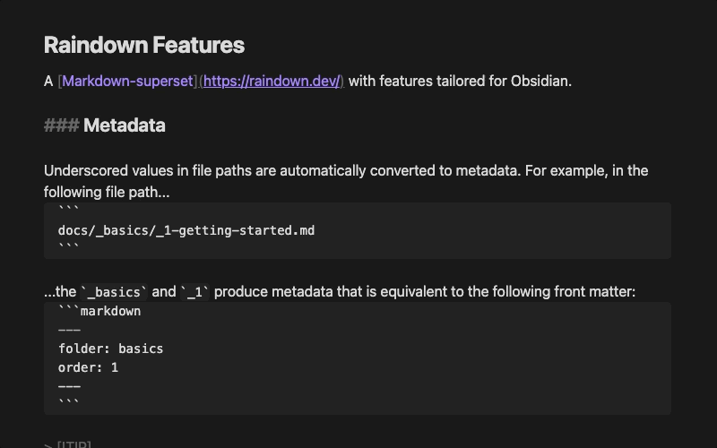

# Raindown for Obsidian

A [Markdown superset](https://raindown.dev/) where data stays current and reads well everywhere.

## Features

- **Portable** - Everyone sees the same thing with or without Raindown/Obsidian, on mobile, desktop and web
- **Nodes** - [table](https://raindown.dev/docs/table), [toc](https://raindown.dev/docs/toc), [chart](https://raindown.dev/docs/chart), [list](https://raindown.dev/docs/list), [schema](https://raindown.dev/docs/schema)
- [**Components**](https://raindown.dev/docs/components) - Create your own custom business logic and output
- **Multi-modal** - [3 input modes](https://raindown.dev/docs/directives) and 2 output modes per component
- **Multi-domain** - Terminal UI, VS Code, Obsidian, static site generation
- **Templating** - Advanced templating layer built on the same syntax

### Table

 

[`table:`](https://raindown.dev/docs/table) Two-way data sync with CSVs. If the CSV doesn't exist it creates it.

### Table of contents



[`toc:`](https://raindown.dev/docs/toc) writes an inline TOC which updates as you add and rename headings.

### Metadata

Underscored values in file paths are automatically converted to metadata. For example, in the following file path...
```
docs/_basics/_1-getting-started.md
```

...the `_basics` and `_1` produce metadata that is equivalent to the following front matter:
```markdown
---
folder: basics
order: 1
---
```

### List

[`list:`](https://raindown.dev/docs/list) writes a link to each note with a tag or in a folder:

````md
list: folder: basics
- [Getting Started](docs/_basics/_1-getting-started.md)
- [Components](docs/_basics/_1-comonents.md)
````

### Charts

[`chart:`](https://raindown.dev/docs/chart) draws a CSV, TSV, JSON or YAML file in your note.

````md
chart: data/reading.csv
```
Jan  ██████████████                 320
Feb  ██████████████████████████████ 540
Mar  █████████████████████          410
```
````

### Components

A note in your vault's `.raindown` folder like `BookCard.md` is a [component](https://raindown.dev/docs/components#markdown). Components can be made with Ruby or Markdown, and referenced anywhere in your Markdown like `BookCard: title: Dune rating: 5`. Editing a Ruby component loads it again at the next write-back.

## Installation

Install [Raindown](https://community.obsidian.md/plugins/raindown) from Obsidian's community plugins: in **Settings → Community plugins**, select **Browse**, search for **Raindown**, select **Install**, then **Enable**.

## Settings

| Setting              | Default    | Description                                                                                         |
| -------------------- | ---------- | --------------------------------------------------------------------------------------------------- |
| **Write-back**       | On         | Write back to a note with directives as you type, and line up any note's tables as you type in them |
| **Bare syntax**      | Off        | Recognise bare directives on their own line like `toc:` (equivalent to CLI `--bare`)                |

A bare directive, on its own line like `toc:`, only writes back in a note with `raindown: true` in its front matter, unless **Bare syntax** is on. Only names Raindown knows like `toc:`, `list:` and your project's nodes write anything, so a line like `Summary:` is left alone.

> [!WARNING]
> Make sure your files are version controlled or backed up before enabling bare syntax, otherwise existing content beneath text like `list:` could be overwritten.

Adding, renaming or removing a note writes back the notes with lists, like `list:`, so they don't go stale.

## Commands

| Command                                      | Does                                                                                   |
| -------------------------------------------- | -------------------------------------------------------------------------------------- |
| **Raindown: Write back this note**           | Writes back now, and says what happened                                                |
| **Raindown: Write back all notes**           | Writes back every note with directives, and says how many changed                      |
| **Raindown: Open this table's file**         | Opens the file of the table at the cursor, in your spreadsheet app                     |

> [!NOTE]
> The plugin doesn't run [endpoints](https://raindown.dev/docs/endpoint) or JavaScript components yet, or show `<{ }>` in reading view. The [CLI](https://raindown.dev/docs/cli) and VS Code extension do.

## Files and network

- **Running Raindown** - Raindown is written in Ruby, but runs inside the plugin compiled to WebAssembly in a background worker. Components can still be written in Ruby, JavaScript or Markdown
- **Files** - It reads a copy of your vault's notes, data files and `.raindown` folders, and writes only the files a note asks it to
- **Network** - The plugin doesn't use the network unless you ask it to via endpoints or run requests via your vault's own Ruby/JavaScript nodes in `.raindown`
