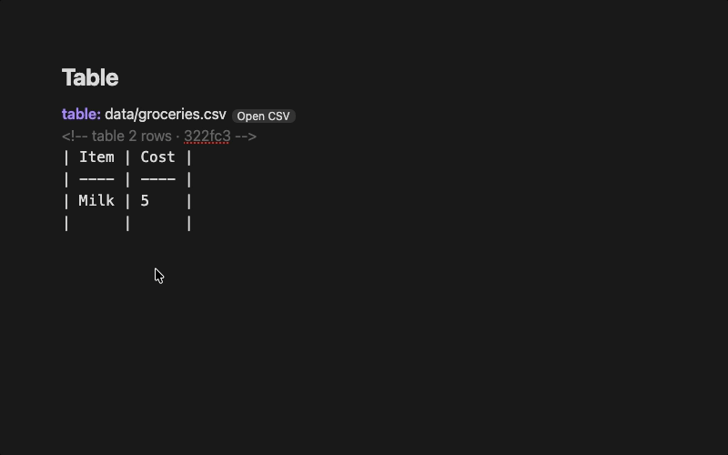

# Raindown for Obsidian

A [Markdown-superset](https://raindown.dev/) with features tailored for Obsidian.

## Features

### Table



[`table:`](https://raindown.dev/docs/table) writes a CSV or TSV file in your vault into the note as a table. Edit a cell and it's written back to the file. Changing the file itself updates the table.
````md
table: 'data/books.csv'
<!-- table 2 rows · f690ac -->
| title    | rating |
| -------- | ------ |
| Dune     | 5      |
| Hyperion | 4      |
````

### Table of contents


[`toc:`](https://raindown.dev/docs/toc) writes an inline TOC which updates as you add and rename headings.

````md
# Books

toc:
- [Reading](#reading)
- [Finished](#finished)

## Reading

## Finished
````

### Metadata

Underscored values in file paths are automatically converted to metadata. For example, in the following file path...
```
docs/_basics/_1-getting-started.md
```

...the `_basics` and `_1` produce metadata that is equivalent to the following front matter:
```markdown
---
folder: basics
order: 1
---
```

> [!TIP]
> Separate multiple folder tags with `&`:
> `docs/_1&_basics/_1-getting-started.md`

### List

[`list:`](https://raindown.dev/docs/list) writes a link to each note with a tag or in a folder, like `list: tags: 'book'`

````md
list: tags: 'book'
- [Dune](books/Dune.md)
- [Hyperion](books/Hyperion.md)
````

### Charts

[`chart:`](https://raindown.dev/docs/chart) draws a CSV, TSV, JSON or YAML file in your vault.

````md
chart: 'data/reading.csv'
```
Jan  ███████████████████████▊                 320
Feb  ████████████████████████████████████████ 540
Mar  ██████████████████████████████▍          410
```
````

### Components

A note in your vault's `.raindown` folder, like `BookCard.md`, is a [component](https://raindown.dev/docs/components#markdown) with no code, a template whose properties fill its `{variables}`, like `BookCard: title: Dune rating: 5`.

## Installation

### The plugin

Install [Raindown](https://community.obsidian.md/plugins/raindown) from Obsidian's community plugins: in **Settings → Community plugins**, select **Browse**, search for **Raindown**, select **Install**, then **Enable**.

### The program

The plugin needs the `raindown` executable, which it can't install for you. Paste one of these commands into a terminal and press Return. It takes about a minute, and running it again updates Raindown. Then select **Check again**, or run **Raindown: Find Raindown** from the command palette.

**macOS and Linux:** open **Terminal**, which you can find on a Mac by pressing Cmd + Space and typing `Terminal`, or on Linux by pressing Ctrl + Alt + T or searching your apps for `Terminal`, then run:

```sh
curl -fsSL https://raindown.dev/install.sh | sh
```

**Windows:** open **PowerShell**, which you can find by pressing the Windows key and typing `PowerShell`, then run this. To update, close Obsidian first, as Windows can't replace a program that's running.

```powershell
irm https://raindown.dev/install.ps1 | iex
```

Both check the download against the release's checksums. You can read them first, at [install.sh](https://raindown.dev/install.sh) and [install.ps1](https://raindown.dev/install.ps1), or [download a binary yourself, or install the gem](https://raindown.dev/docs/cli#installation).

## Settings

| Setting              | Default    | Description                                                                          |
| -------------------- | ---------- | ------------------------------------------------------------------------------------ |
| **Raindown command** | `raindown` | The raindown executable, or its full path                                            |
| **Write-back**       | On         | Write back to a note with directives as you type                                     |
| **Bare syntax**      | Off        | Recognise bare directives on their own line like `toc:` (equivalent to CLI `--bare`) |

A bare directive, on its own line like `toc:`, only writes back in a note with `raindown: true` in its front matter, unless **Bare syntax** is on. Only names Raindown knows like `toc:`, `list:` and your project's nodes write anything, so a line like `Summary:` is left alone.

> [!WARNING]
> Make sure your files are version controlled or backed up before enabling bare syntax, otherwise existing content beneath text like `list:` could be overwritten.

Adding, renaming or removing a note writes back the notes with lists, like `list:`, so they don't go stale.

## Commands

| Command                                      | Does                                                                                   |
| -------------------------------------------- | -------------------------------------------------------------------------------------- |
| **Raindown: Write back this note**           | Writes back now, and says what happened                                                |
| **Raindown: Run the endpoints in this note** | Runs the [endpoints](https://raindown.dev/docs/endpoint) without a response, like `-x` |
| **Raindown: Write back all notes**           | Writes back every note with directives, and says how many changed                      |
| **Raindown: Find Raindown**                  | Looks for Raindown again, once you've installed it                                     |
| **Raindown: Open this table's file**         | Opens the file of the table at the cursor, in your spreadsheet app                     |

> [!NOTE]
> Unlike the [CLI](https://raindown.dev/docs/cli) endpoints in Obsidian never run on save, only via the command.

## Files and network

- **Running Raindown** - Raindown is a separate program, so the plugin runs it to write back to your notes, and starts your shell once to find it on your `PATH`. Like any program you run, Raindown isn't limited to your vault, but the plugin only gives it file paths inside your vault.
- **Network** - The plugin doesn't use the network itself. Raindown calls the URLs in a note's endpoints when you run **Raindown: Run the endpoints in this note**, and your vault's own nodes in `.raindown` are code that can use it too.
